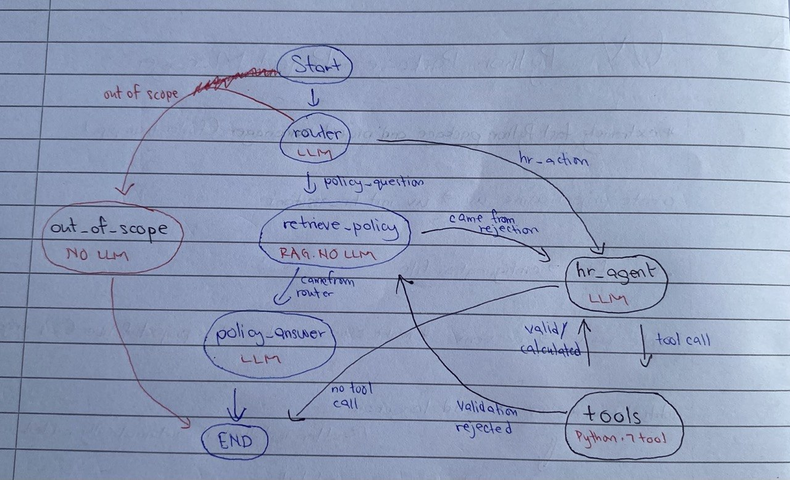

# HR-Assistant

An agentic HR conversational system developed with LangGraph, LangChain, and LangSmith. The application combines a Retrieval-Augmented Generation (RAG) architecture for organizational guidelines with deterministic calculation and policy-validation tools for employee requests.

---

## Architectural Design

The system coordinates multi-step interactions through a directed graph state machine:

- **Router**: Analyzes incoming user messages and classifies intent into informational policy inquiries, action/calculation requests, or out-of-scope interactions.
- **RAG Subsystem**: Chunks and indexes company documentation into a vector store to retrieve grounded context for informational inquiries.
- **Action Agent & Tools**: Binds specialized Python functions for leave eligibility checks, accrual computations, schedule validations, and reimbursement reviews.
- **Feedback Loop**: When an action violates operational constraints, the state machine routes the failure reason back to the retrieval module to supply context on why the request failed.



---

## Repository Layout

```text
hr_assistant/
├── app.py                      # Interactive terminal interface
├── architecture.jpg            # System architecture diagram
├── langgraph.json              # LangGraph configuration
├── pyproject.toml              # Build metadata and dependencies
├── requirement.txt             # Pip dependency list
├── .env.example                # Environment configuration template
├── .gitignore                  # Git exclusions for secrets, caches, and data
├── data/                       # Directory for local documents (excluded from git)
├── src/
│   └── hr_assistant/
│       ├── __init__.py         # Package root
│       ├── assistant.py        # Application wrapper and session management
│       ├── config.py           # Configuration parser and assertions
│       ├── edges.py            # Graph transition definitions
│       ├── graph.py            # Graph assembly and compilation
│       ├── nodes.py            # Node implementations
│       ├── prompt.py           # System prompts
│       ├── rag.py              # Ingestion, embedding, and retrieval pipeline
│       ├── state.py            # TypedDict state structure
│       └── tools.py            # Deterministic business tools
└── test/
    └── Validation_tools.txt    # Verification prompts
```

---

## Getting Started

### Prerequisites

- Python 3.13+
- OpenAI API Key
- LangSmith API Key (Optional, for observability)

### Installation

1. Create and activate a virtual environment:

```bash
python -m venv .venv
# On Windows:
.venv\Scripts\activate
# On Linux / macOS:
source .venv/bin/activate
```

2. Install dependencies:

```bash
pip install -r requirement.txt
```

3. Setup environment configuration:

```bash
cp .env.example .env
```

Populate `.env` with your API credentials:

```env
OPENAI_API_KEY=your_key_here
LANGSMITH_TRACING=true
LANGSMITH_API_KEY=your_key_here
LANGSMITH_AGENT_ID=hr-assistant
```

4. Place your PDF guidelines document inside the `data/` directory.

---

## Usage

### Command Line Interface

Run the assistant interactively in your terminal:

```bash
python app.py
```

### LangGraph Studio

Run the graph development server:

```bash
langgraph dev
```

---

## License

This software is distributed under the terms of the MIT License.
